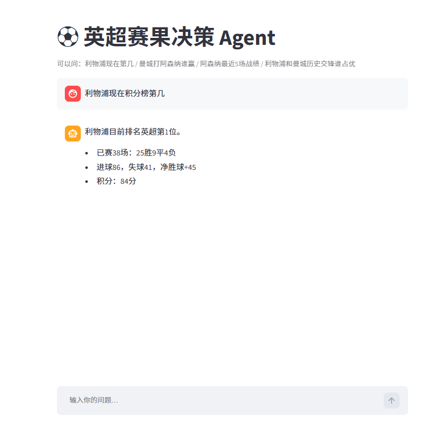

# ⚽ 五大联赛赛果决策 Agent

一个用自然语言提问的足球数据分析 Agent。你问"利物浦现在第几""巴萨打皇马谁赢""德甲前四是谁"，它会自动调用对应的工具查询数据、用训练好的模型预测概率，并用中文回答。

**在线试用：** https://你的应用名.streamlit.app

## 它能回答什么

- 积分榜：利物浦现在积分榜第几 / 给我看看意甲前四名是谁
- 近期战绩：阿森纳最近5场战绩如何 / 曼城最近打了哪些比赛
- 历史交锋：利物浦和曼城历史交锋谁占优
- 比赛预测：曼城打阿森纳谁赢 / 巴萨打皇马谁赢
- 复合问题：查查现在德甲前两名是谁，然后预测一下他们打一场谁赢

## 技术栈

- 数据：football-data.org API，覆盖英超、西甲、德甲、意甲、法甲 2024 赛季
- 分析：Pandas
- 模型：scikit-learn 随机森林（包含近期状态特征），按时间切分，无数据泄露
- Agent：DeepSeek API Function Calling，多工具自动分发
- 界面：Streamlit
- 部署：Streamlit Community Cloud

## 项目文件

- tools.py：工具函数 + Function Calling schema
- predict_v2.py：加载多联赛模型，输出胜平负概率
- train_multi_leagues.py：多联赛模型训练脚本（随机森林）
- fetch_multi_leagues.py：从 API 获取五大联赛数据
- streamlit_app.py：网页界面 + Agent 主循环
- agent_v3.py：命令行版 Agent，开发调试用
- matches_*.csv / standings_*.csv：五大联赛比赛数据与积分榜
- models_multi.pkl：五大联赛各自训练好的随机森林模型
- requirements.txt：依赖清单

## 本地运行

安装依赖：

